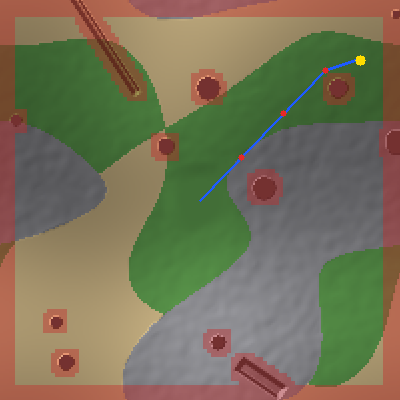

# Navigating Worm

A small, camera-equipped, servo-driven worm robot. It learns its gait with reinforcement learning in MuJoCo, transfers the gait to real hardware, and navigates toward a GPS coordinate.

The main idea is a **terrain-conditioned gait**: the camera classifies the surface and the policy adapts to it.

## Status
Milestone 1, the simulation MVP, is complete. The policy now trains with a sampled terrain class. Next come terrain worlds, a path planner and a click-to-go demo: see the [roadmap](#roadmap). The hardware milestones have not started.

## M1 result
The task: follow a 100 m route of waypoints, 2 m apart, with a 15 cm arrival tolerance. Each run has random friction, servo dynamics and mass. A run fails if any waypoint takes more than 60 s.

| Controller | 10 routes | 50 routes |
|---|---|---|
| Terrain-sampled PPO policy, training seed 0 (committed in `results/policy`) | – | **50 / 50** |
| Terrain-sampled PPO policy, training seed 1 | – | 50 / 50 |
| Terrain-sampled PPO policy, training seed 2 | – | 50 / 50 |
| M1 PPO policy, training seed 0 (history) | 10 / 10 | 49 / 50 |
| M1 PPO policy, training seed 1 (history) | – | 49 / 50 |
| M1 PPO policy, training seed 2 (history) | – | 49 / 50 |
| Hand-written steering on the open-loop gait | 8 / 10 | – |

Each policy trains for 3M steps, about 14 minutes on a laptop CPU. The tables are in [results/](results/).

The terrain-sampled policies train after two fixes. Each episode now draws one terrain class (concrete, grass or sand), sets the friction from that class, and shows the class in the terrain one-hot. Segment inertia now scales with the randomized mass. The M1 rows are history: those policies always saw the "concrete" input, and their numbers predate the fixes. A video of the first 30 s of a route is in [results/route.mp4](results/route.mp4).

[results/showcase.mp4](results/showcase.mp4) shows the policy on a short route that turns in every direction. The left half follows the worm. The right half is a top-down map: red waypoints are pending, grey ones are reached, blue dots are the trail. This video uses nominal physics, not randomized physics.

Known limits:
- All three M1 policies fail the same route. It has a lateral-to-forward friction ratio of 2.15, near the bottom of the randomized range (2 to 6), with high forward friction. The terrain-sampled policies complete all 50 routes.
- The terrain class is fixed for a whole episode, and the ground is a flat plane. Mixed surfaces, slopes and obstacles are on the roadmap.
- Inertia now scales with the randomized mass, but the drag also scales with the mass, so mass still has a modest effect.
- The friction model is a simplification. See below.

## How it works
- **Body:** 5 box segments, 4 yaw servos, modelled on the Feetech SCS0009.
- **Action (7-D):** amplitude, frequency and turn bias of a serpenoid wave, plus one residual per joint.
- **Observation (24-D):** only what the real robot can sense. Joint feedback, IMU, target bearing and distance, previous action, terrain one-hot. Observation v2 (31-D) adds the terrain class and the ground heights ahead.
- **Friction:** a worm moves because the ground resists sideways motion more than forward motion. MuJoCo's own per-axis contact friction is fixed to world axes, so it does not follow a turning segment. A test demonstrates this. The sim instead applies a smooth body-frame drag to each segment (`worm/friction.py`).
- **Sim-to-real preparation:** servo delay, lag, deadband and speed cap; sensor quantization, bias and noise; randomized friction, mass and servo strength.


## Terrain worlds
`worm/world.py` generates a seeded world: hills, fine roughness, rocks, ditches and a surface class per cell (stone/concrete, grass, sand). The world compiles to a MuJoCo heightfield. Each body segment takes its friction, viscous drag and contact softness from the cell under it, and the policy's terrain input is the class under the head.

```
uv run python scripts/make_world.py --seed 1 --size 10 --out map.png   # top-down map
uv run python scripts/bench_env.py --world 10m                          # env throughput
```

```python
from worm.env import WormGoalEnv
from worm.world import WorldConfig, generate

env = WormGoalEnv(world=generate(WorldConfig(size=(10.0, 10.0)), seed=1))
obs, info = env.reset(seed=0, options={"start": (0.0, 0.0), "target": (2.0, 1.0)})
```

The flat-plane env is unchanged; a test pins its trajectory. On slopes the smooth drag model alone creeps downhill, so worlds add real contact friction.

The committed policy never trained on a world. On 10 m mixed-surface worlds without obstacles it still reaches 10 of 10 targets with slopes up to 10 degrees, and 9 of 10 with slopes up to 15 degrees. It does not avoid rocks or ditches; that is the planner's task (M2b).

## Planner
`worm/planner.py` turns a world and a goal into a waypoint route, or a reason why no route exists. It builds a cost map (sand costs more than grass, grass more than stone; rocks, ditch walls and steep ground are blocked), searches it with A*, pulls the path tight and cuts it into waypoints. `worm/navigate.py` drives the route with any policy and replans when the worm is stuck or off the path.



Blue is the path, red dots are waypoints, yellow is the goal. Red-tinted ground is blocked. The route stays on stone where it can.

```
uv run python scripts/plan_map.py --seed 1 --goal 4 3.5 --out plan.png
uv run python scripts/navigate.py --policy results/policy --seed 1 --goal 4 3.5 --video nav.mp4
uv run python scripts/navigate.py --policy scripted --seed 1 --goal 4 3.5   # no trained policy needed
```

With the committed policy, the navigator reached 10 of 10 goals on ten generated 10 m worlds with rocks, ditches and slopes up to 15 degrees. Each goal was at least 4 m away.

## Click to go

```
uv run python scripts/demo.py --open
```

The page is a map with its controls in the gutters. Click a point and the worm plans a route and drives it. A small card at the click shows the route length, or why the goal is refused. A click while the worm drives re-routes it. Keyboard users move a cursor with the arrow keys and press Enter. Pause and the speed presets sit beside the map. The follow-cam inset appears when the server renders. The Map settings drawer makes a new map: seed, size, ground mix, slope, rocks and ditches. The page uses the Atkinson Hyperlegible font from `worm/static/fonts/` (SIL Open Font License). The demo drives the terrain policy in `results/policy_terrain` by default. Use `--policy results/policy` for the flat policy, `--policy scripted` for the scripted controller and `--no-render` to skip the 3D view. The server listens on localhost only.

## Train the terrain policy
The terrain policy takes observation v2: the 24 inputs of v1 plus the terrain class 0.25 m ahead (3) and four ground heights ahead of the head (4), 31 in total. Both additions model real sensors, with classifier errors and range noise. It trains on a curriculum of 8 m worlds: level ground of one class, then mixed surfaces, then hills and roughness, then steeper hills with shallow ditches and rocks. No rock sits on the line to the target, because the planner owns obstacle avoidance. Each saved run has a `meta.json` with its observation version, so old policies keep loading.

```
uv run python scripts/train.py --config configs/terrain_v2_smoke.toml           # 20k steps, a pipeline check
scripts/cloud/launch.sh --config configs/terrain_v2.toml --seeds 0 --n-envs 8   # 20M steps, detached
scripts/cloud/status.sh                                                         # steps, level, speed, time left
scripts/cloud/stop.sh                                                           # checkpoint and end
scripts/cloud/launch.sh --config configs/terrain_v2.toml --seeds 0 --n-envs 8 --resume
uv run tensorboard --logdir runs
uv run python scripts/eval_terrain.py --policy runs/terrain_v2_seed0 --maps 50 --flat-routes 50 --json eval.json
```

To train on a rented Hetzner Cloud VM instead, one command creates the server, trains every seed, copies the results back, verifies them and deletes the server. It needs the `hcloud` CLI and an SSH key in the Hetzner project. Try it with `--dry-run` first: that prints every command and runs nothing.

```
export HCLOUD_TOKEN=...        # in the shell only, never in a file
scripts/cloud/run_remote.sh --ssh-key NAME --config configs/terrain_v2.toml --seeds 0,1,2 --n-envs 15
```

Billing stops only when the server is deleted. The script deletes it only after the results are complete on your machine, and says so when it does not. A failsafe on the VM deletes the server after `--max-hours` (default 12) in every case. Check the Hetzner console afterwards.

A run writes checkpoints every 1M steps and keeps the newest three. SIGTERM saves a checkpoint, and `--resume` continues the step count. On a 12-core laptop CPU with 8 envs the run makes about 2,600 steps per second, so 20M steps take about two and a half hours.

`eval_terrain.py` drives one planned route of at least 5 m on each of 50 generated 10 m worlds per level. Level 1 is level ground with mixed surfaces. Level 2 adds hills up to 10 degrees and roughness. Level 3 is the full terrain: hills up to 18 degrees, rocks and ditches.

### Result
Training seed 0, 20M steps, about 2 h 25 min on a 12-core laptop CPU with 8 envs. The policy is in `results/policy_terrain`. "Flat policy" is the committed M1 policy in `results/policy` (observation v1), on the same 50 worlds and routes per level.

| Level | Flat policy (v1) | Terrain policy (v2), seed 0 | Seed 1 | Seed 2 |
|---|---|---|---|---|
| 1, mixed surfaces, level ground | 50 / 50 | **50 / 50** | 50 / 50 | 50 / 50 |
| 2, hills to 10 degrees, roughness | 50 / 50 | **50 / 50** | 50 / 50 | 50 / 50 |
| 3, full terrain with rocks and ditches | 46 / 50 | **49 / 50** | 47 / 50 | 49 / 50 |
| Sand speed on level 3 | 0.071 m/s | **0.102 m/s** | 0.099 m/s | 0.099 m/s |
| Flat 100 m routes (regression check) | 50 / 50 | 49 / 50 | 49 / 50 | 49 / 50 |

Seed 0 trained on the laptop. Seeds 1 and 2 trained on a rented 16-core cloud VM, about 4.9 hours for both.

Per-terrain breakdown on level 3, seed 0:

| | Flat policy (v1) | Terrain policy (v2) |
|---|---|---|
| Speed on concrete | 0.115 m/s | 0.165 m/s |
| Speed on grass | 0.093 m/s | 0.126 m/s |
| Speed on sand | 0.071 m/s | 0.102 m/s |
| Time share concrete / grass / sand | 27 / 37 / 36 % | 25 / 39 / 36 % |
| Replans per route | 0.34 | 0.12 |
| Mean time per route | 79 s | 61 s |
| Failures by class under the head | concrete 2, grass 1, sand 1 | concrete 1 |

The gate for this milestone, set before training, for seed 0:

| Metric | Target | Result | |
|---|---|---|---|
| Level 1 success | at least 90 % | 100 % | pass |
| Level 3 success | at least 80 % | 98 % | pass |
| Beats the flat policy | 10 points more on level 3, or 15 % faster on sand at equal success | 6 points more; 43 % faster on sand | pass, by the sand branch |
| Per-terrain breakdown | reported | above | pass |
| Flat 100 m routes | at least 48 / 50 | 49 / 50 | pass |

Notes:
- The flat policy already reaches 92 % on level 3, so a gain of 10 points was out of reach. The terrain policy is faster on every surface and replans less.
- Seeds 1 and 2 pass the same gate. Seed 1 gains only 2 points on level 3 and passes by sand speed (39 % faster).
- All three seeds, and the flat policy, fail the route on world 2013 of level 3.
- Each terrain policy lost one flat 100 m route that the flat policy completes.
- The tables are in `results/terrain_eval_seed{0,1,2}.json` and `results/terrain_eval_baseline_v1.json`.

## Roadmap
The next milestones:
1. **M2a Terrain world:** seeded heightfield worlds with hills, rocks, ditches and a surface class per cell.
2. **M2b Planner:** a cost map and A* route over a world, or a reason why no route exists.
3. **M2c Click to go:** a local web page where a click on the map sends the worm there.
4. **M2d Terrain-aware policy:** terrain and height cues ahead of the head, trained on a curriculum of worlds.

## Run it
Install [uv](https://docs.astral.sh/uv/), then:

```
make check                                   # format, lint, types, tests
uv run python scripts/train.py --out runs/ppo
uv run python scripts/eval_route.py --policy results/policy --video route.mp4
uv run python scripts/showcase.py            # writes results/showcase.mp4
```

## License
MIT
