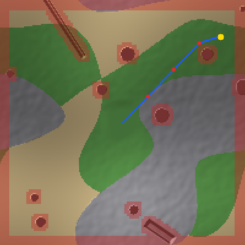

# Navigating Worm

A small, camera-equipped, servo-driven worm robot. It learns its gait with reinforcement learning in MuJoCo, transfers the gait to real hardware, and navigates toward a GPS coordinate.

The main idea is a **terrain-conditioned gait**: the camera classifies the surface and the policy adapts to it.

## Status
Milestone 1, the simulation MVP, is complete. The policy now trains with a sampled terrain class. Next come terrain worlds, a path planner and a click-to-go demo: see the [roadmap](#roadmap). The hardware milestones have not started.

## M1 result
The task: follow a 100 m route of waypoints, 2 m apart, with a 15 cm arrival tolerance. Each run has random friction, servo dynamics and mass. A run fails if any waypoint takes more than 60 s.

| Controller | 10 routes | 50 routes |
|---|---|---|
| Terrain-sampled PPO policy, training seed 0 (committed in `results/policy`) | – | **50 / 50** |
| Terrain-sampled PPO policy, training seed 1 | – | 50 / 50 |
| Terrain-sampled PPO policy, training seed 2 | – | 50 / 50 |
| M1 PPO policy, training seed 0 (history) | 10 / 10 | 49 / 50 |
| M1 PPO policy, training seed 1 (history) | – | 49 / 50 |
| M1 PPO policy, training seed 2 (history) | – | 49 / 50 |
| Hand-written steering on the open-loop gait | 8 / 10 | – |

Each policy trains for 3M steps, about 14 minutes on a laptop CPU. The tables are in [results/](results/).

The terrain-sampled policies train after two fixes. Each episode now draws one terrain class (concrete, grass or sand), sets the friction from that class, and shows the class in the terrain one-hot. Segment inertia now scales with the randomized mass. The M1 rows are history: those policies always saw the "concrete" input, and their numbers predate the fixes. A video of the first 30 s of a route is in [results/route.mp4](results/route.mp4).

[results/showcase.mp4](results/showcase.mp4) shows the policy on a short route that turns in every direction. The left half follows the worm. The right half is a top-down map: red waypoints are pending, grey ones are reached, blue dots are the trail. This video uses nominal physics, not randomized physics.

Known limits:
- All three M1 policies fail the same route. It has a lateral-to-forward friction ratio of 2.15, near the bottom of the randomized range (2 to 6), with high forward friction. The terrain-sampled policies complete all 50 routes.
- The terrain class is fixed for a whole episode, and the ground is a flat plane. Mixed surfaces, slopes and obstacles are on the roadmap.
- Inertia now scales with the randomized mass, but the drag also scales with the mass, so mass still has a modest effect.
- The friction model is a simplification. See below.

## How it works
- **Body:** 5 box segments, 4 yaw servos, modelled on the Feetech SCS0009.
- **Action (7-D):** amplitude, frequency and turn bias of a serpenoid wave, plus one residual per joint.
- **Observation (24-D):** only what the real robot can sense. Joint feedback, IMU, target bearing and distance, previous action, terrain one-hot.
- **Friction:** a worm moves because the ground resists sideways motion more than forward motion. MuJoCo's own per-axis contact friction is fixed to world axes, so it does not follow a turning segment. A test demonstrates this. The sim instead applies a smooth body-frame drag to each segment (`worm/friction.py`).
- **Sim-to-real preparation:** servo delay, lag, deadband and speed cap; sensor quantization, bias and noise; randomized friction, mass and servo strength.

See [docs/PLAN.md](docs/PLAN.md) for the architecture, later milestones and bill of materials.

## Terrain worlds
`worm/world.py` generates a seeded world: hills, fine roughness, rocks, ditches and a surface class per cell (stone/concrete, grass, sand). The world compiles to a MuJoCo heightfield. Each body segment takes its friction, viscous drag and contact softness from the cell under it, and the policy's terrain input is the class under the head.

```
uv run python scripts/make_world.py --seed 1 --size 10 --out map.png   # top-down map
uv run python scripts/bench_env.py --world 10m                          # env throughput
```

```python
from worm.env import WormGoalEnv
from worm.world import WorldConfig, generate

env = WormGoalEnv(world=generate(WorldConfig(size=(10.0, 10.0)), seed=1))
obs, info = env.reset(seed=0, options={"start": (0.0, 0.0), "target": (2.0, 1.0)})
```

The flat-plane env is unchanged; a test pins its trajectory. On slopes the smooth drag model alone creeps downhill, so worlds add real contact friction. [docs/decisions/0002-terrain-world-physics.md](docs/decisions/0002-terrain-world-physics.md) has the measurements.

The committed policy never trained on a world. On 10 m mixed-surface worlds without obstacles it still reaches 10 of 10 targets with slopes up to 10 degrees, and 9 of 10 with slopes up to 15 degrees. It does not avoid rocks or ditches; that is the planner's task (M2b).

## Planner
`worm/planner.py` turns a world and a goal into a waypoint route, or a reason why no route exists. It builds a cost map (sand costs more than grass, grass more than stone; rocks, ditch walls and steep ground are blocked), searches it with A*, pulls the path tight and cuts it into waypoints. `worm/navigate.py` drives the route with any policy and replans when the worm is stuck or off the path.



Blue is the path, red dots are waypoints, yellow is the goal. Red-tinted ground is blocked. The route stays on stone where it can.

```
uv run python scripts/plan_map.py --seed 1 --goal 4 3.5 --out plan.png
uv run python scripts/navigate.py --policy results/policy --seed 1 --goal 4 3.5 --video nav.mp4
uv run python scripts/navigate.py --policy scripted --seed 1 --goal 4 3.5   # no trained policy needed
```

With the committed policy, the navigator reached 10 of 10 goals on ten generated 10 m worlds with rocks, ditches and slopes up to 15 degrees. Each goal was at least 4 m away. [docs/decisions/0003-planner.md](docs/decisions/0003-planner.md) has the details.

## Roadmap
The next milestones are in [docs/PLAN.md](docs/PLAN.md#milestones), with the reasons for their order in [docs/decisions/](docs/decisions/):
1. **M2a Terrain world:** seeded heightfield worlds with hills, rocks, ditches and a surface class per cell.
2. **M2b Planner:** a cost map and A* route over a world, or a reason why no route exists.
3. **M2c Click to go:** a local web page where a click on the map sends the worm there.
4. **M2d Terrain-aware policy:** terrain and height cues ahead of the head, trained on a curriculum of worlds.

## Run it
Install [uv](https://docs.astral.sh/uv/), then:

```
make check                                   # format, lint, types, tests
uv run python scripts/train.py --out runs/ppo
uv run python scripts/eval_route.py --policy results/policy --video route.mp4
uv run python scripts/showcase.py            # writes results/showcase.mp4
```

## License
MIT
