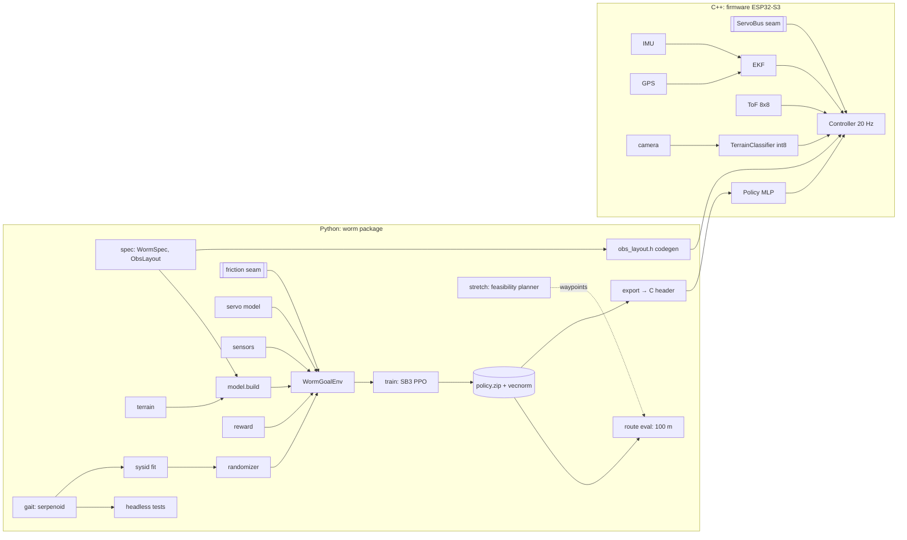

# Navigating Worm — Architecture Plan

## Context
A small, camera-equipped, servo-driven worm robot learns its gait with RL in MuJoCo, transfers sim-to-real, and navigates toward a GPS coordinate. The unique angle is a **terrain-conditioned gait**: the camera classifies the surface and the policy adapts. The stretch goal is a **global feasibility planner** ("can a 15 cm robot get from A to B?").

Constraints: a $150 hardware budget and a 3D printer. The first milestone, **M1**, is a simulation-only MVP.

## Settled decisions
Sim-to-real · two-level system (global planner + local physical leg) · $150 budget · MVP = sim RL gait · v1 small worm (ESP32-S3 + camera + VL53L5CX + IMU + GPS, custom EKF, micro-ROS later; v2 lidar body later) · RL on locomotion only · primary = terrain-adaptive, stretch = global planner · MuJoCo + Gymnasium + SB3 PPO · lateral undulation · train on 1–3 m targets; MVP done = 100 m waypoint route (2 m spacing, 15 cm tolerance, ≥9/10 runs, random friction) · MJCF from scratch, matched to real servos · real-sensor-only observations · one policy conditioned on terrain class · 5-layer sim-to-real (design → sysID → video calibration → randomization → staged validation) · serial-bus feedback servos · int8 terrain CNN on ESP32-S3 · uv/ruff/mypy/pytest/headless tests/PlatformIO/CI.

## Verified facts and corrected assumptions
| Assumption | Finding | Effect on plan |
|---|---|---|
| SCS0009 costs ~$8–12 | ❌ **$15–19 each**. Specs: 4.8–6 V, 2.3 kg·cm, half-duplex TTL bus, 10-bit position feedback, 23×12×25 mm | 5 servos ≈ $80–95, so the BOM is over budget. See open question 1 |
| ESP32 talks to the servo bus directly | ❌ Half-duplex single wire needs a direction buffer (74HC126 + 74HC04, ~$2) or a Waveshare-style bus driver | Add to BOM; firmware `ServoBus` handles TX/RX turnaround |
| MuJoCo anisotropic friction "just works" | ⚠️ Per-axis tangential coefficients exist (docs: "can be used to model skating"), but tangent axis orientation comes from the collision detector and is **not user-controllable** per the docs | Put friction behind a **seam with 2 adapters**. Run a spike test first (see M1 step 2) |
| SB3 + Gymnasium current | ✅ SB3 2.9.0 (Jun 2026) allows Gymnasium <2.0 and torch ≥2.8 | Pin `stable-baselines3>=2.9,<3`, `gymnasium>=1.0,<2` |
| XIAO ESP32S3 Sense ~$15 | ✅ ~$14–20 (camera moving OV2640 → OV3660) | Keep |
| VL53L5CX ~$15 | ⚠️ $20–23 (Pololu 3417 $19.95; Pimoroni $23.40) | Update BOM |
| Headless CI/cloud machines render MuJoCo video | ❓ Unknown (EGL/OSMesa availability) | Try `MUJOCO_GL=egl`, then `osmesa`, else skips video and logs it. Video is not a blocker |
| Training compute enough to reach 100 m success | ❓ Unknown | Pipeline + partial training is acceptable. Record status in `PROGRESS.md` |

## System architecture (all milestones)


**The key cross-cutting contract:** `spec.py` is the single source of truth for the observation and action layout, scales and limits. Codegen emits `obs_layout.h` for the firmware, so sim and robot cannot drift apart.

## Module design (deep modules, small interfaces)
| Module | Interface (what callers know) | Hidden behind it |
|---|---|---|
| `worm/spec.py` | `WormSpec` (n_segments, seg_len, mass, servo limits), `ObsLayout`, `ActionSpec` dataclasses | Constants matched to the SCS0009 datasheet; one place to change morphology |
| `worm/model.py` | `build(spec, terrain) -> mujoco.MjModel` | Loads `assets/worm.xml`, edits it via `mujoco.MjSpec` (segments, actuators, sensors, friction geoms) |
| `worm/friction.py` (**seam**) | `FrictionModel.apply(model, data, params)` called every physics step | Adapter A `ContactAnisotropic` (MuJoCo per-axis contact friction). Adapter B `ResistiveForce` (per-segment body-frame forward/lateral drag via `xfrc_applied`). The spike picks the default |
| `worm/servo.py` | `ServoModel.reset(params)`, `.command(target) -> applied_target` per control step | Delay buffer (1–3 steps), first-order lag, deadband, speed cap, voltage sag |
| `worm/sensors.py` | `SensorSuite.read(data, target, rng) -> obs dict` | Joint feedback quantization (1024 steps), IMU noise and bias, simulated EKF bearing/distance noise |
| `worm/terrain.py` | `TerrainClass` enum {CONCRETE, GRASS, SAND}; `params(cls, rng) -> FrictionParams` | Friction ranges per class (M1: one class with wide range) |
| `worm/randomize.py` | `DomainRandomizer(level).sample(rng) -> PhysicsParams` | Ranges, curriculum level, sysID-centered means (M3) |
| `worm/reward.py` | `reward(prev, cur, action, prev_action) -> (float, terms: dict)` (pure) | Progress toward target, heading alignment, action-rate penalty, energy, success bonus |
| `worm/gait.py` | `serpenoid(t, amp, freq, wave, bias, n) -> joint targets` (pure) | Classic serpenoid curve; baseline, test fixture, sysID excitation |
| `worm/env.py` | Gymnasium `WormGoalEnv`: `reset(seed, options)`, `step(action)`; `options={"target": (x,y)}` lets callers inject a waypoint | Composes all of the above; 20 Hz control, physics substeps, 30 s episodes, termination rules |
| `worm/route.py` | `run_route(policy, env, waypoints, tol=0.15) -> RouteResult` | Advances targets on arrival without resetting the body; timeouts; logs the trajectory |
| `scripts/train.py` | CLI: `--steps --n-envs --seed --out` | SB3 PPO, `SubprocVecEnv`, `VecNormalize`, eval + checkpoint callbacks, TensorBoard |
| `scripts/eval_route.py` | CLI: `--policy --runs 10 --length 100 --video` | Random friction per run, success table, optional MP4 |
| `scripts/codegen_header.py` | Writes `firmware/include/obs_layout.h` | From `spec.py` (M4) |
| `worm/sysid.py` (M3) | `fit(real_traj, param_space) -> PhysicsParams` | Rollout of the serpenoid gait in sim vs ArUco-tracked video; CMA-ES/scipy |
| `firmware/lib/ServoBus` (**seam**, M3) | `setTargets(int16[5])`, `readPositions(int16[5]) -> bool` | SCS protocol, checksum, half-duplex turnaround. Adapters: `ScsServoBus` (real), `FakeServoBus` (native unit tests) |
| `firmware/lib/Ekf` (M4) | `predict(imu, dt)`, `updateGps(fix)`, `bearingDistanceTo(target)` | Planar EKF state (x, y, yaw, yaw-bias) |
| `planner/` (stretch) | `plan(start, goal) -> Route \| Infeasible(reason)` | OSM + DEM adapters, slope/water/road costs |

**Seams with 2 real adapters:** `FrictionModel`, `ServoBus`, and later the planner data source. Everything else is plain composition, with no speculative interfaces.

### Observation / action (M1, in `spec.py`)
**Body (decided): 5 segments, 4 SCS0009 yaw joints** (~$64–76 for servos; BOM ≈ $145–150).
- **Obs (24):** joint positions (4, quantized to 1024 steps) · joint position deltas (4) · IMU yaw rate (1) · roll/pitch (2) · target bearing sin/cos in body frame (2) · target distance, clipped to 3 m (1) · previous action (7) · terrain one-hot (3, fixed length; constant in M1).
- **Action (decided): CPG params + residual, 7-D in [-1, 1]:** serpenoid amplitude, frequency, turn bias (3) + per-joint residual offsets (4, scaled to ±15°). An internal phase accumulator in `env` (not the policy) advances the wave, so the motion stays smooth. `gait.serpenoid` computes the base targets; residuals add on top; `ServoModel` clamps them to the joint limits.

### Data flow per control step (20 Hz)
`action → ServoModel.command → data.ctrl → (FrictionModel.apply + mj_step) × substeps → SensorSuite.read → obs; reward(prev, cur) → terminated (reached / flipped) / truncated (30 s)`

## Repo layout (public; no private info)
```
navigating-worm/
  README.md  CLAUDE.md  PROGRESS.md
  LICENSE (MIT)  Makefile  pyproject.toml  uv.lock
  .github/workflows/check.yml  .github/PULL_REQUEST_TEMPLATE.md
  docs/PLAN.md  (this plan)
  worm/ {spec,model,friction,servo,sensors,terrain,randomize,reward,gait,env,route}.py
  worm/assets/worm.xml
  scripts/ {train,eval_route,spike_friction}.py
  tests/ {test_model,test_gait,test_env,test_reward,test_route,test_friction}.py
  firmware/  (M3+, PlatformIO)
  results/   (small: learning curve PNG, eval JSON; large checkpoints git-ignored)
```
`make check` = `uv run ruff format --check . && uv run ruff check . && uv run mypy worm && uv run pytest -q` (CI: `astral-sh/setup-uv` + `make check`).

**Privacy rule for every pushed file:** no real names, emails, absolute paths or personal setup references.

## Milestones
1. **M1 Sim MVP.**
   1. Scaffold: pyproject, Makefile, CI, `spec.py`, `worm.xml` (5 capsule segments, 4 yaw hinges, position actuators).
   2. **Friction spike** (`scripts/spike_friction.py` + `test_friction.py`): push one segment forward vs sideways. Pick the adapter that gives a ≥3:1 lateral/forward resistance ratio and a reliably oriented frame. Record the result in `PROGRESS.md`.
   3. Serpenoid open-loop gait test: the worm must advance >20 cm in 10 s (proves the friction setup). This is the headline headless test.
   4. Servo, sensors, reward, randomizer, env + `gymnasium.utils.env_checker.check_env` test.
   5. `train.py`: PPO short smoke run in tests (~2k steps); then a real run with as many steps as the session allows.
   6. `route.py` + `eval_route.py`; report success out of 10.
   7. README (results, how to run), `PROGRESS.md`, PR.
2. **M2 Terrain-conditioned navigation**, in four parts. [MVP_PLAN.md](MVP_PLAN.md) is the execution plan. Decisions are recorded in [decisions/](decisions/).
   - **M2a World.** A seeded procedural world: a heightfield with hills, roughness, rocks and ditches, plus a surface class per cell (concrete, grass, sand). It compiles to a MuJoCo `hfield`. Each segment takes its friction, viscous drag and contact softness from the cell under it. The flat-plane env stays bit-identical.
   - **M2b Planner.** A pure-Python cost map and A* search over a world. It returns a smoothed waypoint route or `Infeasible(reason)`. A navigator drives the route with any policy and replans when the worm is stuck or off the path.
   - **M2c Click-to-go.** A local web page served by the standard-library HTTP server. It shows a top-down map; a click sets a goal, and the worm plans and drives there. It runs with the committed policy or a scripted fallback.
   - **M2d Terrain-aware policy.** Observation v2 adds the terrain class ahead and four height samples ahead, all plausible for the real camera and ToF sensor. Training uses a curriculum of worlds, config files, checkpoints and resume. Old policies keep loading through a versioned observation layout. The laptop CNN on real surface photos moves to M4.
3. **M3 Hardware + sysID:** print the body, `ServoBus` driver + fake, servo step-response video, tilt-board friction, ArUco calibration fit.
4. **M4 Deploy:** MLP export + codegen header, int8 CNN (ESP-DL/TFLM), EKF, ToF stop, open-loop vs policy validation.
5. **Stretch:** feasibility planner, micro-ROS bridge, teacher–student/RMA, v2 lidar body.

## BOM (verified prices, approx. USD)
| Item | Price |
|---|---|
| XIAO ESP32S3 Sense (camera, 8 MB PSRAM) | 15–20 |
| 4× Feetech SCS0009 | 64–76 |
| VL53L5CX carrier (Pololu 3417) | 20 |
| GPS u-blox M10 | ~15 |
| IMU (BMI270/ICM-42688 breakout) | ~6 |
| 2S LiPo + charger + 6 V buck | ~20 |
| Half-duplex buffer ICs, wire, screws | ~5 |
| Filament | ~0 |

## Verification
- `make check` passes locally and in CI.
- The serpenoid gait test passes. The env check passes.
- The README states the route eval result honestly, including partial training progress.
